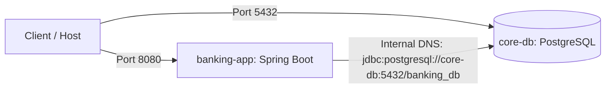
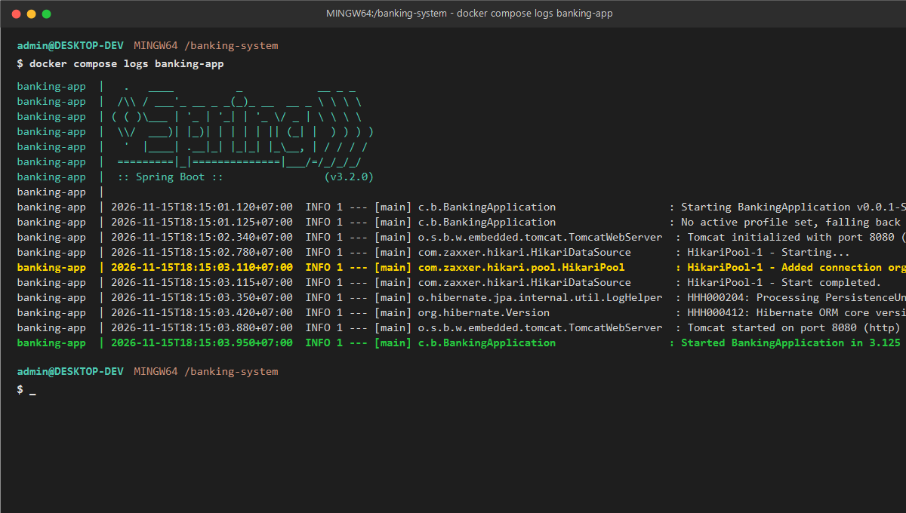

# Session 06 - Bài tập 1: Chạy Spring Boot Service cùng Database bằng Docker Compose

## 1. Mục tiêu bài tập
- Nắm vững cú pháp và cấu trúc chuẩn của tệp tin `docker-compose.yml`.
- Đóng gói (Dockerize) ứng dụng Spring Boot với Dockerfile tối ưu.
- Cấu hình biến môi trường kết nối database động trong môi trường container.
- Thiết lập cơ chế kiểm tra trạng thái database (`healthcheck`) kết hợp `depends_on (service_healthy)` để ứng dụng khởi động an toàn, loại bỏ hoàn toàn lỗi **Connection Refused** kinh điển.

---

## 2. Kiến trúc và Cấu hình Hệ thống

Hệ thống bao gồm 2 services chính hoạt động trong cùng một mạng nội bộ Docker Compose:



### 2.1. Cấu hình Cơ sở dữ liệu (`core-db`)
- **Image**: `postgres:15-alpine` (gọn nhẹ, bảo mật).
- **Database Name**: `banking_db`.
- **Cổng ánh xạ**: `5432:5432`.
- **Lưu trữ dữ liệu**: Volume `core_db_data` gắn vào `/var/lib/postgresql/data`.
- **Healthcheck**: Sử dụng lệnh `pg_isready -U postgres -d banking_db` để liên tục kiểm tra trạng thái sẵn sàng tiếp nhận kết nối của PostgreSQL.

### 2.2. Cấu hình Ứng dụng Ngân hàng (`banking-app`)
- **Dockerfile**: Base image `eclipse-temurin:17-jre-alpine`, `WORKDIR /app`, `ENTRYPOINT ["java", "-jar", "app.jar"]`.
- **Cổng ánh xạ**: `8080:8080`.
- **Biến môi trường Datasource**:
  - `SPRING_DATASOURCE_URL=jdbc:postgresql://core-db:5432/banking_db`
  - `SPRING_DATASOURCE_USERNAME=postgres`
  - `SPRING_DATASOURCE_PASSWORD=postgres`
  - `SPRING_JPA_HIBERNATE_DDL_AUTO=update`
- **Điều kiện phụ thuộc**:
  ```yaml
  depends_on:
    core-db:
      condition: service_healthy
  ```
  Giúp container Spring Boot chỉ khởi động tiến trình chính khi và chỉ khi PostgreSQL đã thực sự sẵn sàng mở cổng lắng nghe kết nối.

---

## 3. Cấu trúc thư mục

```text
Banking-Session6-B1/
├── banking-app/
│   ├── build/
│   │   └── libs/
│   │       └── banking-app-0.0.1-SNAPSHOT.jar
│   ├── src/
│   │   └── main/
│   │       ├── java/com/banking/
│   │       │   ├── controller/AccountController.java
│   │       │   ├── entity/Account.java
│   │       │   ├── repository/AccountRepository.java
│   │       │   └── BankingApplication.java
│   │       └── resources/
│   │           └── application.properties
│   ├── build.gradle
│   ├── Dockerfile
│   └── settings.gradle
├── homework/
│   └── session_06/
│       └── exercise_01/
│           └── banking_app_log.png
├── docker-compose.yml
└── README.md
```

---

## 4. Hướng dẫn khởi chạy và kiểm thử

### Bước 1: Khởi động hệ thống
Từ thư mục gốc dự án:
```bash
docker compose up -d --build
```

### Bước 2: Kiểm tra trạng thái các container
```bash
docker compose ps
```
Cả hai container `core-db` và `banking-app` sẽ ở trạng thái `Up (healthy)` hoặc `Up`.

### Bước 3: Xem log khởi động của `banking-app`
```bash
docker compose logs -f banking-app
```
Log sẽ ghi nhận HikariCP kết nối thành công tới cơ sở dữ liệu `banking_db` tại máy chủ `core-db:5432`.

### Bước 4: Kiểm tra API
Thực hiện tạo tài khoản và tra cứu:
```bash
# Tạo tài khoản mẫu
curl -X POST http://localhost:8080/api/accounts \
  -H "Content-Type: application/json" \
  -d '{"accountNumber":"10987654321","ownerName":"Nguyen Van A","balance":5000000.0}'

# Tra cứu danh sách tài khoản
curl http://localhost:8080/api/accounts
```

---

## 5. Minh chứng kết quả (Proof of Work)

Log khởi động container `banking-app` kết nối thành công HikariCP tới `banking_db`:


